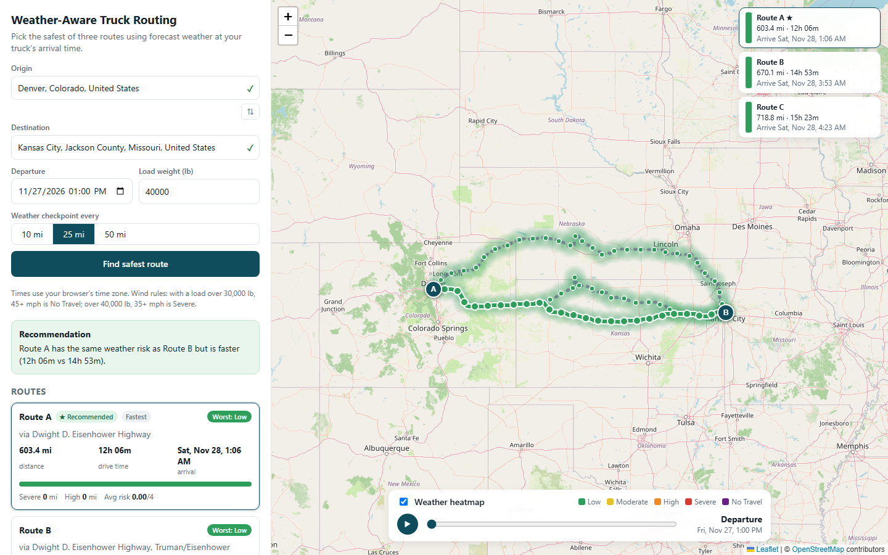
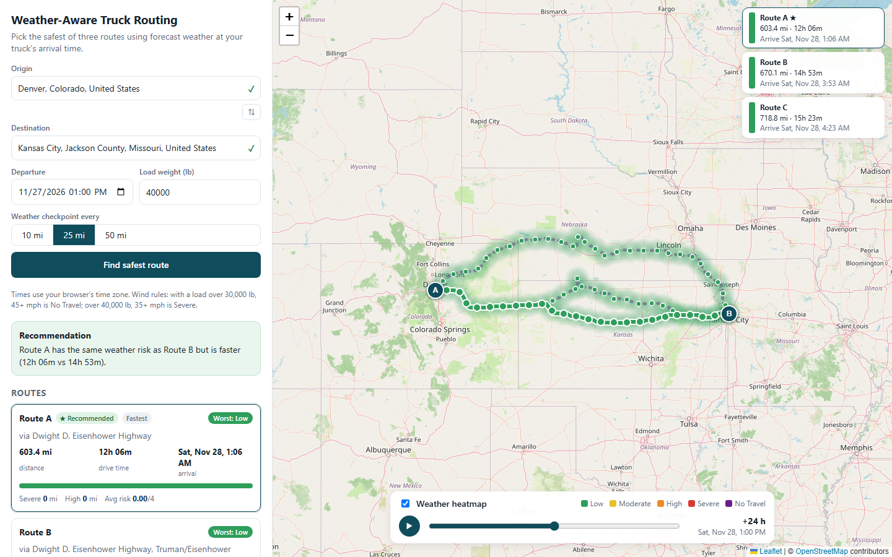

# Weather-Aware Truck Routing

React + Django app that helps a truck driver pick the safest of **three routes** based on forecast
weather *at the time the truck actually reaches each point*, the **load weight**, and travel time.

* **Hosted app:** _add URL after deploy_ (see [Deploy](#deploy))
* **Loom walkthrough:** _add link_ (talking points in [Walkthrough outline](#loom-walkthrough-outline))

  




## What it does

1. Enter origin, destination, departure date/time and load weight (lb). Choose a checkpoint spacing of 10 / 25 / 50 miles.
2. The backend gets **3 distinct routes**, places a checkpoint every N miles, computes the truck's **ETA at each
   checkpoint**, reads the forecast for *that hour* at *that location*, and classifies risk.
3. Routes are ranked and one is **recommended** with a one-line reason.
4. The map shows every route (selected one coloured by risk), checkpoint markers with popups, ETAs and a
   per-route summary (distance, drive time, arrival, miles by risk level, average risk).
5. A **weather heatmap** along the corridor has a **0-48 h forecast slider** (plus play/pause and hover details).

## Requirements coverage

| Requirement from the brief | Where it is implemented / verified |
|---|---|
| Inputs: origin, destination, departure date/time, load weight | `TripForm.tsx`, validated again server-side (`serializers.py`) |
| 3 route options from a routing API | `routing.py` (OSRM + via-point fallback); `test_analysis.RouteGenerationTests` |
| Weather every 10 / 25 / 50 mi at the truck's **ETA** | `analysis._analyze_route`; `test_analysis.ArrivalTimeWeatherTests` (a storm 4-6 h after departure hits only checkpoints reached then) |
| Risk from the provided rules + load rules | `risk.py`; `test_risk.py` (every band edge and load rule) |
| Recommendation: Severe mi -> High mi -> avg risk -> time | `recommendation.py`; `test_recommendation.py` |
| All routes, checkpoints, risk, ETAs, summaries **on the map** | `RouteLayers.tsx` (all routes + all checkpoints), `MapRouteSummary.tsx`, route tooltips/popups |
| Weather heatmap along the corridor, 0-48 h slider | `RiskHeatLayer.ts`, `HeatmapControl.tsx`; `test_analysis.test_heatmap_hours_follow_the_forecast` |
| Deliverables | Repo + `Dockerfile`/`render.yaml` for hosting + Loom outline below |

Verified live against the real APIs: Dallas-Fort Worth (1 s), Seattle-Miami at 50 mi (7 s) and LA-New York at 10 mi,
281 checkpoints per route (13 s) all return 3 routes with a recommendation.

## Architecture

```
frontend/ (Vite + React + TS + Leaflet)         backend/ (Django + DRF, stateless, no DB)
  TripForm ── POST /api/analyze/ ───────────►   views.AnalyzeView
  PlaceInput ─ GET /api/geocode/ ───────────►   views.GeocodeView ── services/geocoding   (Nominatim)
  RouteCard / CheckpointTable                   services/analysis  (orchestrator)
  MapView                                         ├─ services/routing         (OSRM, 3 routes)
    RouteLayers (routes, checkpoints)             ├─ services/geo             (distance, sampling, simplify)
    HeatmapLayer ─ RiskHeatLayer (canvas)         ├─ services/weather         (Open-Meteo, batched + cached)
    HeatmapControl (slider)                       ├─ services/risk            (thresholds + load rules)
                                                  └─ services/recommendation  (ranking + explanation)
                                                presenters.py -> JSON
```

Third-party APIs (all **keyless**, so the project runs with zero setup):

| Concern   | Provider                                    | Notes |
|-----------|---------------------------------------------|-------|
| Routing   | OSRM (`router.project-osrm.org`)            | `alternatives` + via-point fallback to guarantee 3 routes. Swap with `OSRM_BASE_URL`. |
| Geocoding | Nominatim / OpenStreetMap                   | Debounced, cached 24 h. Optional `NOMINATIM_COUNTRY_CODES`. |
| Weather   | Open-Meteo hourly forecast                  | Wind (mph), rain+showers and snowfall (in/hr). Batched 50 points/request, cached 20 min. |

### How the logic works (the 40 % that matters)

**Route generation** (`routing.py`). OSRM's `alternatives` frequently returns fewer than 3 routes. If so, extra
candidates are made by routing through a via-point pushed sideways from the middle of the fastest route (two sides,
two distances). Candidates sharing >= 90 % of their path with a kept route, or slower than 1.75x the fastest, are dropped.
Routes are named A, B, C by speed.

**Checkpoints & ETA** (`geo.py`, `analysis.py`). Checkpoints sit at 0, N, 2N ... plus the destination. ETA =
departure + cumulative OSRM per-segment driving time up to that mile, divided by `TRUCK_SPEED_FACTOR` (default 0.85,
because OSRM models a car). Weather is linearly interpolated between the two surrounding forecast hours at the ETA.

**Risk** (`risk.py`). Per checkpoint, wind / rain / snow are classified with the brief's table and the worst wins.
Load rules: wind >= 55 -> No Travel for any load; 45-54 mph and > 30,000 lb -> No Travel; 35-44 mph and > 40,000 lb -> Severe.
Edge handling for ranges that touch (documented in code and unit-tested): a value exactly on a band edge belongs to the
higher band, except rain > 1.00 and snow > 3.0 which are strict "greater than" per the brief.

**Miles per level.** Each checkpoint "owns" the road halfway to its neighbours, so owned miles sum exactly to the route
length. This gives Severe / High miles and a mile-weighted average risk (0 = Low ... 4 = No Travel).

**Recommendation** (`recommendation.py`). Lexicographic: fewest Severe miles -> fewest High miles -> lowest average
risk -> shortest time (compared at 0.1 mi / 0.01 / 1 min so noise doesn't decide a winner). **One deliberate addition:**
*No Travel* miles are compared before Severe, because a stretch where travel is prohibited must never lose to a route that
merely has fewer Severe miles. If every route hits No Travel the app still ranks them and shows a warning.

**Heatmap** (`analysis._build_heatmap`, `RiskHeatLayer.ts`). Corridor samples (>= 25 mi apart, <= 60 per route) get a risk
level for each of the 49 hours after departure, computed server-side with the same rules and load weight. The slider then
only repaints one canvas (no requests, no React re-render of the map). The layer uses a *geographic* radius so the corridor
keeps its true width when zooming, and paints worst risk on top instead of summing intensities (which would make dense
sampling look artificially risky).

### Performance choices
* Weather for all checkpoints + heatmap points is **one deduplicated, batched, parallel** fetch; points snap to a 0.01 deg grid.
* Route geometry is Douglas-Peucker simplified (~50 m) and pre-split into risk-coloured segments server-side; responses are gzipped.
* Canvas rendering (`preferCanvas`), `React.memo` on route layers, rAF-throttled heatmap/hover drawing.

## API

`POST /api/analyze/`
```json
{
  "origin":      {"lat": 41.8781, "lon": -87.6298, "label": "Chicago"},
  "destination": {"lat": 33.7490, "lon": -84.3880, "label": "Atlanta"},
  "departure_time": "2026-12-01T14:00:00Z",
  "load_weight_lb": 42000,
  "checkpoint_interval_miles": 25
}
```
Returns `routes[]` (summary, `metrics`, risk-coloured `segments`, `checkpoints[]` with ETA/weather/risk), `recommended_route_id`,
`recommendation`, `heatmap{hours,start,points[]}` and `warnings[]`. Errors: `{"error":{"code","message"}}`.
`GET /api/geocode/?q=...`, `GET /api/health/`.

## Run locally

Requirements: Python 3.11+, Node 20+.

**Quick start (one command runs both servers):**

```bash
npm run setup     # once: venv + backend deps + .env + frontend deps
npm run dev       # API on :8000, app on http://localhost:5173 (Ctrl+C stops both)
npm test          # backend + frontend tests
# busy port?  BACKEND_PORT=8123 FRONTEND_PORT=5199 npm run dev
```

Or run them separately:

```bash
# backend
cd backend
python -m venv .venv && source .venv/bin/activate      # Windows: .venv\Scripts\activate
pip install -r requirements.txt
cp .env.example .env                                   # DJANGO_DEBUG=true for local dev
python manage.py runserver 8000
python manage.py test                                  # 34 tests

# frontend (new terminal)
cd frontend
npm install
npm run dev                                            # http://localhost:5173 (proxies /api -> :8000)
# if port 8000 is busy:  API_PROXY=http://localhost:8123 npm run dev
npm test && npm run build

# lint backend (also runs in CI: .github/workflows/ci.yml)
cd ../backend && ruff check .
```

## Deploy

One container serves everything (Django + WhiteNoise serves the built React app), so there is no CORS or second host.

* **Render:** New > Blueprint > select this repo. `render.yaml` is included (free plan, health check `/api/health/`).
* **Any Docker host:** `docker build -t truck-routing . && docker run -p 8000:8000 -e DJANGO_SECRET_KEY=change-me truck-routing`

Env vars: see `backend/.env.example` (`DJANGO_SECRET_KEY` required in production).

## Assumptions & known limitations

* ETAs/forecast times are interpreted in the **browser's time zone** (ISO with offset is sent to the API).
* No hours-of-service breaks are modelled; a multi-day trip simply keeps driving. Truck restrictions (height, hazmat, bridges) are not
  applied because the free OSRM profile is for cars; `TRUCK_SPEED_FACTOR` compensates for speed only.
* Forecast horizon: departure must be within 10 days. Wind is 10 m sustained speed (gusts are not used).
* Snow threshold is applied to Open-Meteo `snowfall` (inches of snow per hour); rain is `rain + showers`.
* The public OSRM / Nominatim servers are for light use. For production traffic, point `OSRM_BASE_URL` / `NOMINATIM_BASE_URL` at your own instance
  or a commercial provider; the service layer is the only code that changes.
* In-memory cache (per process). Swap Django's `CACHES` for Redis if you scale out.

## Loom walkthrough outline (5-10 min)

1. **Demo (2 min):** Chicago -> Atlanta with a 45,000 lb load; show recommendation, 3 cards, checkpoint popups, table.
2. **Heatmap (1 min):** toggle, drag slider 0-48 h, press play, hover for details.
3. **Risk logic (2 min):** `risk.py` thresholds + load rules, boundary convention, tests in `test_risk.py`.
4. **Recommendation (1.5 min):** `recommendation.py`, why No Travel is ranked first, change load weight and show the winner flipping.
5. **Architecture & performance (2 min):** services split, batched/cached weather, simplified geometry, canvas heat layer.
6. **Trade-offs (1 min):** limitations above and what you'd do next (HOS, truck-aware routing, Redis, gusts).
